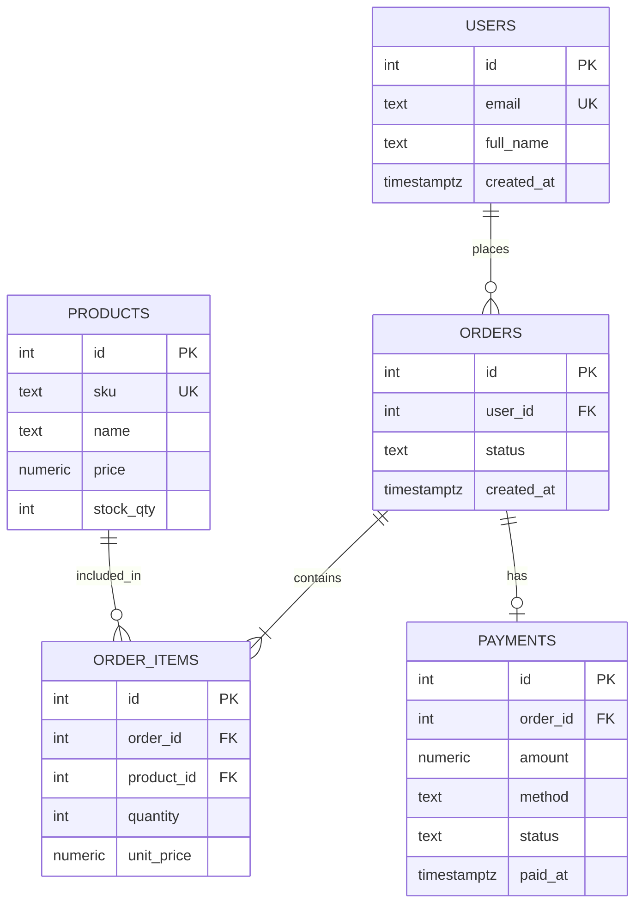
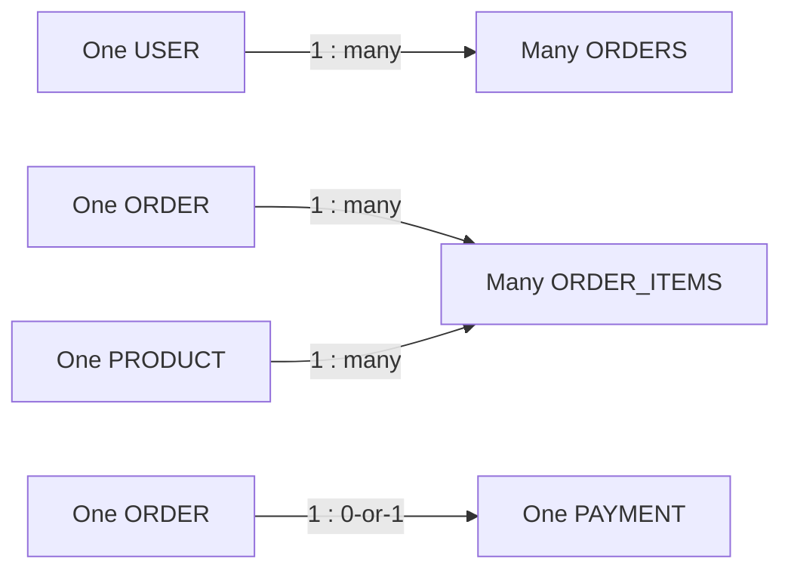

# Chapter 1: Diagrams

## Entity-Relationship diagram for this chapter's schema

## Relationship cardinality cheat sheet

- `||--o{` = "exactly one" on the left, "zero or many" on the right
- `||--|{` = "exactly one" on the left, "one or many" on the right
- `||--o|` = "exactly one" on the left, "zero or one" on the right
